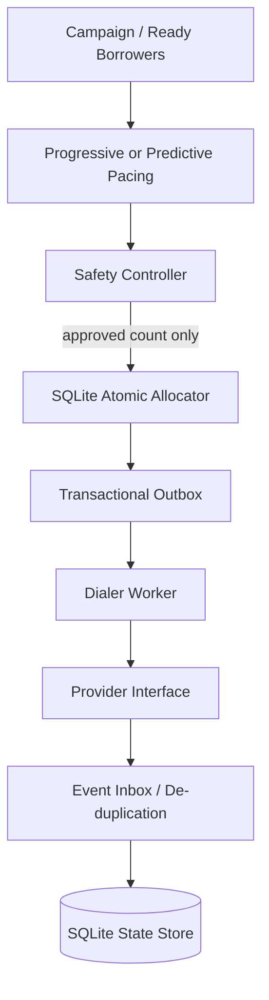
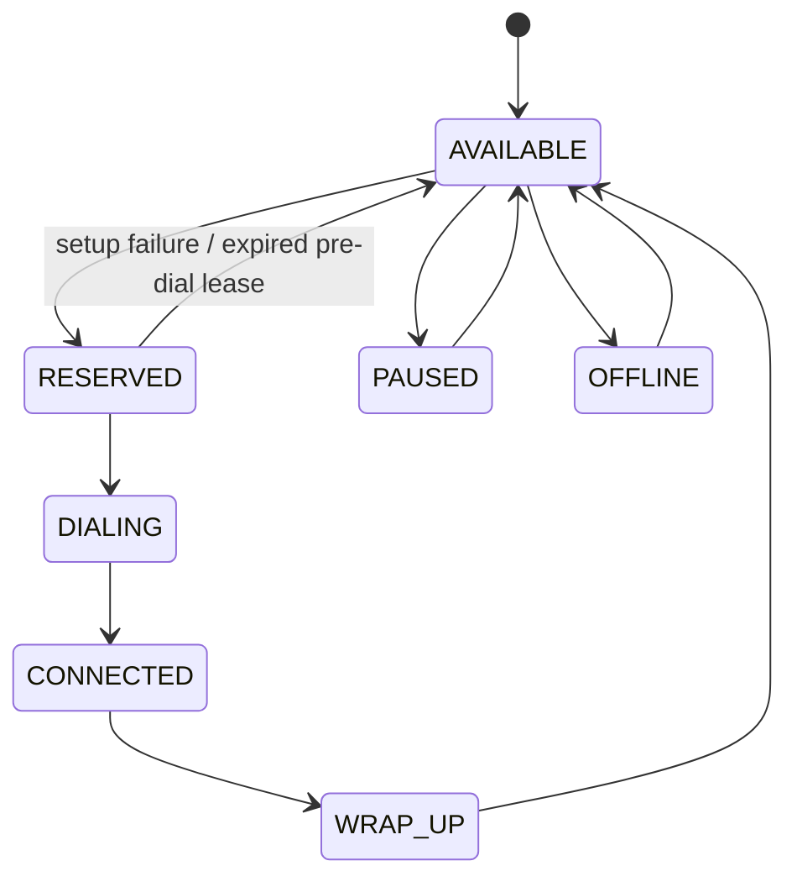
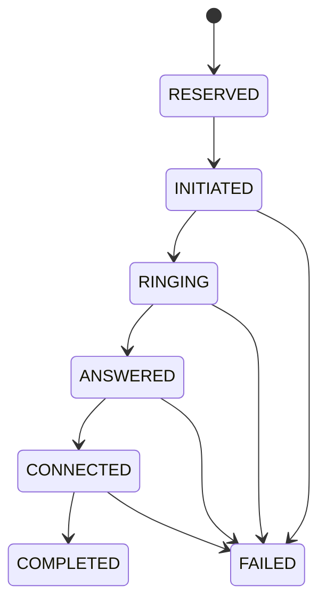

# SmartDialer — beginner-friendly submission prototype

A safety-first outbound dialer prototype built with Python's standard library. It includes
Progressive and Predictive pacing, a separate Safety Controller, atomic agent/borrower
allocation, two mock providers, durable SQLite state, event de-duplication, recovery, tests,
a simulator and a basic concurrent allocation load test.

**No real telephone calls are placed.** Telecom providers are simulated.

## Requirements
- Python 3.10 or newer
- `pytest` only for running tests; the application itself uses the Python standard library

## Run on Windows
Open Command Prompt in this folder and run:

```bat
python --version
python run_demo.py --reset
```

Choose `1` for Progressive or `2` for Predictive, then choose Provider `A` or `B`.
The demo creates 3 agents and 8 borrowers in `smartdialer.db`. Provider A is the faster mock; Provider B adds a short setup delay and can time out or send duplicate/out-of-order events.

Run four predictive scenarios:

```bat
python run_demo.py --scenarios
```

Run tests:

```bat
pip install pytest
pytest -q
```

Show deterministic failure-case examples (crash lease, provider outage, agent drop, duplicate and late events):

```bat
python run_demo.py --failures
```

Run a basic allocation load test:

```bat
python load_test.py --agents 100 --workers 16
```

Use `--reset` to start the demo database from scratch. The application stores state in
SQLite, so agent/call records survive a program restart.

## Architecture



The pacing engines calculate a requested number only. They do not contact providers.
The Safety Controller clamps the request to the number of currently AVAILABLE agents and
READY borrowers and blocks new work when the provider circuit is open. The allocator uses
one SQLite `BEGIN IMMEDIATE` transaction, conditional updates and partial unique indexes
so two local workers cannot reserve the same agent or borrower.

## Agent state machine



## Call state machine



## Important design choices

1. **SQLite instead of a large infrastructure stack.** It is easy to run locally and supports
   transactions, durable state and concurrent writers. The database is the source of truth.
2. **Safety is separate from pacing.** Both pacing modes return a request. Only the safety
   controller returns an approval, and `run_cycle` passes only that approval to allocation.
3. **Progressive mode.** Requests one call per currently available agent.
4. **Predictive mode.** Estimates spare slots using answer rate, ringing calls and average
   talk time, then converts that estimate to a call request. For this prototype the safety
   controller still refuses to exceed currently available agents. This favours no abandoned
   connected calls over aggressive over-dialling.
5. **Concurrency.** Allocation uses `BEGIN IMMEDIATE`, conditional state changes, and unique
   partial indexes for one active call per agent/borrower. The test starts multiple threads
   against the same SQLite database.
6. **Events.** `(provider, event_id)` is unique in the event inbox. A sequence watermark and
   legal transition map reject duplicates, stale events and state regressions.
7. **Outbox.** Reservation and the `START_CALL` outbox row are committed in the same
   transaction. A restarted worker polls pending outbox rows and retries using the same call ID
   as an idempotency key. Event IDs are also stable in the mock provider, so replay is safe.
8. **Provider outage.** Three consecutive mock initiation timeouts open a circuit breaker.
   New calls are blocked until `provider_recovered()` is called. Existing calls are not
   disconnected by the breaker.
9. **Worker crash.** A lease reaper releases calls that are still RESERVED (no provider
   initiation). INITIATED/RINGING calls are not blindly retried: they remain reserved until
   provider status is reconciled. Connected calls remain assigned until a completion event.

## Mock providers

- **Provider A:** no simulated initiation timeout; ordered callbacks; configurable answer rate.
- **Provider B:** slower/unreliable behaviour represented by initiation timeouts, duplicate
  callbacks and out-of-order callbacks. Both providers share the same interface.

## Simulation profiles

`python run_demo.py --scenarios` runs these example profiles:

| Scenario | Answer rate | Average talk time |
|---|---:|---:|
| A | 20% | 120 seconds |
| B | 50% | 90 seconds |
| C | 70% | 180 seconds |
| D | 10% | 240 seconds |

Output includes requested and approved calls, provider outcomes, agent states, safety approval/rejection counters, call counters and an agent-utilization proxy (agents that were occupied or in wrap-up at the end of the batch divided by total agents). It is not a time-based utilization benchmark.
The demo is intentionally short and does not model real time call durations.

## What happens at larger scale?

- **100 agents:** SQLite and the local worker model are appropriate for a prototype.
- **1,000 agents:** full-table selection and one SQLite writer become bottlenecks. Add indexed
  queue queries and consider PostgreSQL row-level locking with `SKIP LOCKED`.
- **10,000 agents:** database write contention, event throughput, provider rate limits and
  campaign hot spots become major constraints. Partition by campaign/shard, use a durable
  message broker only where needed, and keep per-agent/borrower uniqueness enforced by the DB.

## Limitations and production hardening

This is a practical prototype, not a production telecom platform. The simulator has no real
voice integration, dial-time scheduling, consent/time-zone/do-not-call checks, audit service,
agent desktop, authentication, or real provider reconciliation API. The Provider B timeout
is explicitly simulated as a timeout before call creation; real HTTP timeouts can be ambiguous
and must be reconciled with the provider using an idempotency key before retrying. For production,
add those compliance controls, monitoring, operational dashboards, stronger retry policy,
provider status reconciliation and a PostgreSQL deployment.
